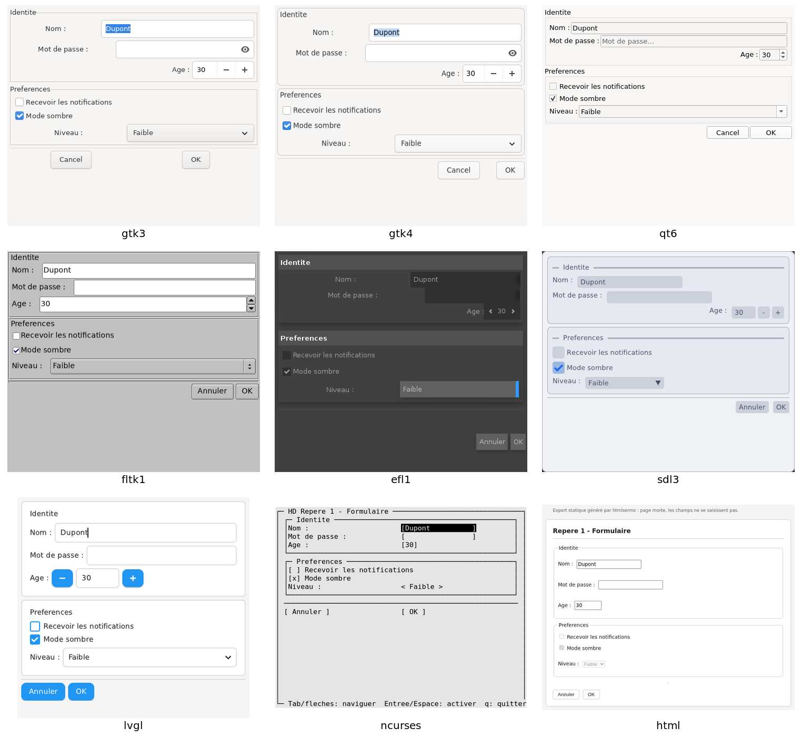

# sermo

**sermo** ouvre, depuis un script shell, une boîte de dialogue décrite en **XML**,
puis écrit sur sa sortie les valeurs saisies (`NOM="Jean"`). Le même script
tourne sur huit bibliothèques graphiques : GTK 3, GTK 4, Qt 6, FLTK, EFL, SDL 3,
LVGL, et ncurses dans un terminal. Un neuvième port, html, n'ouvre rien : il
écrit le dialogue en page HTML.



*Le même script, [`examples/showcase/01-formulaire.sh`](examples/showcase/01-formulaire.sh),
rendu par les binaires des paquets 2.7.1-1. efl1 garde son thème sombre même
quand le thème clair est demandé ([TODO.md](TODO.md)). L'image se refait avec
[`doc/captures/refaire.sh`](doc/captures/refaire.sh).*

[English](README.en.md)

## D'où vient sermo

sermo est un fork de **gtkdialog 0.8.3**, écrit par Pere László (2003-2007) puis
repris par Thunor (2011-2013), sous GPL-2.0-or-later. La lignée d'origine continue
chez Puppy Linux : <https://github.com/puppylinux-woof-CE/gtkdialog>. Qui a fait
quoi, quand, et où en sont les autres descendants (gtk3dialog, gtkdialog3) :
[HISTOIRE.md](HISTOIRE.md).

sermo garde le langage XML et l'analyseur de gtkdialog. Il remplace GTK 2 par
neuf couches de rendu autour d'un cœur commun, et borne l'exécution des
commandes. Ce qui vient de l'amont et ce qui a été écrit ici est compté fichier
par fichier dans [LICENCES.md](LICENCES.md).

## État du projet

- Version **3.1.2**. sermo est tenu par **un seul mainteneur**, S. Cage. Il n'y a
  pas d'équipe derrière : une réponse peut prendre du temps.
- Une partie du code, de la documentation et des tests a été écrite avec l'aide
  d'une IA (Claude, d'Anthropic), sous la direction du mainteneur. Il l'essaie et
  en signale les défauts, mais ne relit plus tout le code ligne à ligne : la
  vérification repose surtout sur les bancs, que chacun peut rejouer
  ([AUTHORS](AUTHORS)).
- **Ce qui est vérifié** : 178 bancs (analyse XML, valeurs exportées, sécurité,
  clics, ouverture des exemples réels, serveurs MCP) sur les neuf ports au
  passage complet du 2026-10-11, détaillé dans [BILAN_SANTE.md](BILAN_SANTE.md).
  Au passage complet (`ci/bancs.sh`, programmes d'aide compris) :
  262 bancs, 0 échec (passage final de la 3.1.2, 2026-10-19). Au passage du 2026-10-18, un banc était rouge (des fonctions
  interdites dans le code du lecteur son et vidéo) ; il a été corrigé puis
  rejoué vert. Chaque chiffre se rejoue par une commande.
- **Ce que sermo lit et écrit dehors**, par des programmes d'aide installés à
  part : un automate en Modbus ou OPC UA (lecture seule) ; la domotique MQTT
  (lire, et publier si une liste blanche le permet) ; un drone MAVLink (lire sa
  télémétrie ; régler un paramètre du drone désarmé, lui envoyer une mission
  sans la lancer, ou donner un ordre de sécurité : retour au départ,
  atterrissage, coupure des moteurs en deux appuis) ; le son et la vidéo, joués
  par mpv. sermo ne pilote pas un drone : il ne l'arme pas, ne le fait pas
  décoller et ne le dirige pas, hors retour au départ et atterrissage de
  sécurité. Les paquets sont dans « Installer ».
- **Écarts connus** : les ports sans GTK s'écartent encore de gtk3sermo sur
  quelques points (`auto-refresh`, libellé du bouton Annuler, `<terminal>`…).
  Ils sont listés dans [TODO.md](TODO.md).
- **Pas de dépôt apt** : les paquets Debian sont joints à chaque publication
  (voir « Installer »).

## Exemple

```sh
export MAIN_DIALOG='
<window title="Bonjour">
  <vbox>
    <text><label>Votre nom ?</label></text>
    <entry><variable>NOM</variable></entry>
    <hbox><button ok></button><button cancel></button></hbox>
  </vbox>
</window>'
sermo --program=MAIN_DIALOG
```

Après avoir tapé « Jean » et cliqué sur OK, la sortie est la même sur chaque
port qui affiche le dialogue :

```
NOM="Jean"
EXIT="OK"
```

Un script lit ces lignes avec `eval "$(sermo --program=MAIN_DIALOG)"` : les
valeurs sont échappées pour cela. Quand quelqu'un d'autre que l'auteur remplit le
dialogue, préférez `--do` ([SECURITY.md](SECURITY.md)).

## Les neuf ports

| Port | Bibliothèque | Commande | Paquet |
|---|---|---|---|
| gtk3 | GTK 3 | `gtk3sermo` | `sermo-backend-gtk3` |
| gtk4 | GTK 4 | `gtk4sermo` | `sermo-backend-gtk4` |
| qt6 | Qt 6 | `qt6sermo` | `sermo-backend-qt6` |
| fltk1 | FLTK 1.4 | `fltk1sermo` | `sermo-backend-fltk1` |
| efl1 | EFL (Enlightenment) | `efl1sermo` | `sermo-backend-efl1` |
| sdl3 | SDL 3 et Dear ImGui | `sdl3sermo` | `sermo-backend-sdl3` |
| lvgl | LVGL 9.6, embarqué (Wayland, X11 ou framebuffer) | `lvglsermo` | `sermo-backend-lvgl` |
| ncurses | ncurses, en terminal | `ncursessermo` | `sermo-backend-ncurses` |
| html | aucune : page HTML autonome | `htmlsermo` | `sermo-backend-html` |

- **gtk3sermo est l'étalon** : les huit autres ports sont mesurés contre lui.
- **html est un exportateur** : il n'ouvre pas de fenêtre, il écrit le dialogue
  en une page HTML autonome (CSS embarqué, sans JavaScript par défaut) dans le fichier que nomme
  `SERMO_HTML_OUT` (défaut `sermo-output.html`). Avec `SERMO_HTML_MODE=serve`,
  un micro-serveur local sert la page et renvoie les valeurs saisies.
- Seuls gtk3 et gtk4 ont `<terminal>` (VTE) et `--glade-xml` ; seul gtk3 a
  l'ancrage Wayland (`layer-shell`).
- Chaque paquet ne tire que sa bibliothèque : `sermo-backend-fltk1` n'installe ni
  GTK ni Qt, `sermo-backend-ncurses` ne demande que ncurses.

Le cœur `libsermocore` (analyse du XML, variables, actions, exécution des
commandes) est lié dans chaque binaire ; le backend ne fait que dessiner. Le port
ncurses a été ajouté sans changer une ligne du cœur. Architecture :
[MANUEL_DEVELOPPEUR.md](MANUEL_DEVELOPPEUR.md).

## Autres systèmes

Hors de Linux, un seul port tourne : **ncurses**, dans un terminal.

| Système | Comment l'obtenir | Vérifié |
|---|---|---|
| Windows 10 et 11 | `sermo-<version>-windows-x86_64.zip`, joint à la publication : un seul `ncursessermo.exe`, rien à installer | banc de comportement sous Wine ; affichage et accents sur un vrai Windows 11, commandes et accents sur un vrai Windows 10 |
| Android (Termux) | recette [`packaging/autres-os/termux/build.sh`](packaging/autres-os/termux/build.sh), à construire dans Termux | sur un téléphone (Android 15, arm64) |
| FreeBSD, OpenBSD | ports [`packaging/autres-os/freebsd/`](packaging/autres-os/freebsd/) et [`openbsd/`](packaging/autres-os/openbsd/) | dans des machines virtuelles (FreeBSD 15.1, OpenBSD 7.9) |
| macOS | formule Homebrew [`packaging/autres-os/homebrew/sermo.rb`](packaging/autres-os/homebrew/sermo.rb) | sur un runner macOS (Apple Silicon) |

« Vérifié » veut dire : le port y rend les mêmes valeurs que gtk3sermo sur le banc
de comportement et sur les dialogues des scripts métier. Seul Windows a un
binaire publié ; pour Android, les BSD et macOS, il n'y a que les recettes.

- Construire : [COMPILE.md](COMPILE.md) §7.
- Ce qui change pour la sécurité (pas de plafond des `<input>` sous Windows,
  durcissement selon le processeur) : [SECURITY.md](SECURITY.md).
- Le détail de chaque essai : [packaging/autres-os/README.md](packaging/autres-os/README.md).

## Installer

Il n'y a pas de dépôt apt. Les paquets Debian sont joints à la publication
[**v3.1.2**](https://gitlab.com/haplo-dialog/sermo/-/releases/v3.1.2), avec leurs
sommes de contrôle : on télécharge, on vérifie, on installe.

```sh
U=https://gitlab.com/api/v4/projects/85674825/packages/generic/sermo/3.1.2
for f in sermo-backend-gtk3_3.1.2-2_amd64.deb sermo-gtkdialog_3.1.2-2_all.deb SHA256SUMS SHA256SUMS.asc; do
    curl -fLO "$U/$f"
done
curl -fLO https://haplo-dialog.fr/cle-haplo-dialog.asc
gpg --import cle-haplo-dialog.asc
gpg --verify SHA256SUMS.asc SHA256SUMS
sha256sum --ignore-missing -c SHA256SUMS
sudo apt install ./sermo-backend-gtk3_3.1.2-2_amd64.deb \
                 ./sermo-gtkdialog_3.1.2-2_all.deb
```

Pour un autre port, remplacez `gtk3` par `gtk4`, `qt6`, `fltk1`, `efl1`, `sdl3`,
`lvgl`, `ncurses` ou `html`. Les paquets sont construits sur **Debian testing (amd64)** et demandent
ses versions de bibliothèques (Qt ≥ 6.11.2 pour qt6, glibc ≥ 2.43 pour sdl3…).
Ailleurs, compilez depuis les sources.

Les sommes sont signées par la clé de haplo-dialog. `gpg --verify` doit dire
« Bonne signature de haplo-dialog <devel@haplo-dialog.fr> », avec l'empreinte :

```
66C7 F4AD 7A58 A037 967F  8339 3799 9F99 7570 F1ED
```

La clé publique est sur le site (`https://haplo-dialog.fr/cle-haplo-dialog.asc`) ;
l'empreinte, ici, dans le dépôt. Comparez-la à celle de ce README sur GitLab
(<https://gitlab.com/haplo-dialog/sermo>) **et** sur GitHub
(<https://github.com/haplo-dialog/sermo>) : une clé remplacée sur le site ne le
serait pas partout à la fois.

Ce qui est signé, c'est la liste des sommes (`SHA256SUMS`), pas chaque `.deb`
un par un : un paquet est sûr parce que sa somme figure dans une liste dont la
signature est bonne. Il n'y a pas non plus de dépôt apt signé.

**Lire et écrire dehors** : chaque programme d'aide a son paquet, à installer
en plus du port (même téléchargement, même vérification) :

| Pour | Paquets |
|---|---|
| lire un automate | `sermo-source-modbus`, `sermo-source-opcua` |
| la domotique MQTT | `sermo-source-mqtt` (lire), `sermo-cible-mqtt` (publier) |
| un drone MAVLink | `sermo-source-mavlink` (lire), `sermo-cible-mavlink` (régler, mission, ordres de sécurité) |
| le son et la vidéo | `sermo-cible-media` (jouer ; tire `mpv`, recommande `bubblewrap`), `sermo-source-media` (suivre l'état) |

Qui n'installe que la lecture ne peut rien écrire. Les listes blanches et les
gardes sont dans [SECURITY.md](SECURITY.md) et le
[manuel utilisateur](MANUEL_UTILISATEUR.md).

**Construire les paquets vous-même** (Debian testing, Docker) :
`bash packaging/construire-paquets.sh` construit dans un conteneur vierge, passe
lintian, installe et purge les paquets pour vérifier qu'ils ne laissent rien.
Sur une Debian testing, `sudo apt build-dep ./` puis `dpkg-buildpackage -us -uc -b`
suffit aussi. Détails :
[PACKAGING.md](PACKAGING.md).

**Compiler depuis les sources** : [COMPILE.md](COMPILE.md).

Après installation :

- la commande **`sermo`** désigne l'un des ports installés, choisi par
  `update-alternatives` (gtk3 en premier) ;
  `sudo update-alternatives --config sermo` en choisit un autre ;
- pour les anciens scripts qui appellent **`gtkdialog`**, installez en plus
  `sermo-gtkdialog`. Il remplace les paquets `gtkdialog` et `gtk3dialog` : on
  garde l'un ou l'autre, pas les deux.

## Désinstaller

```sh
sudo apt purge sermo-gtkdialog sermo-backend-gtk3
```

La purge ne laisse ni fichier ni alternative (vérifié dans un conteneur vierge).
Compilé depuis les sources sans `install` : supprimez le dossier de construction.

## Venir de la 1.x

Installez les paquets actuels (3.1.0) des ports que vous utilisez (`sermo-backend-gtk3`,
`sermo-gtkdialog`…) : apt retire les paquets 1.x qu'ils remplacent (`gtk3sermo`,
`gtksermo`…). Les commandes gardent leur nom. Ce qui change et comment faire :
[MIGRATION.md](MIGRATION.md).

## Documentation

- [Manuel utilisateur](MANUEL_UTILISATEUR.md) — écrire des dialogues : widgets,
  actions, variables, options.
- [Manuel développeur](MANUEL_DEVELOPPEUR.md) — le cœur, les backends, ajouter un
  port.
- `man sermo` et `info sermo`, installés avec chaque port.
- [COMPILE.md](COMPILE.md) · [PACKAGING.md](PACKAGING.md) ·
  [DEPENDENCIES.md](DEPENDENCIES.md) · [VERSIONING.md](VERSIONING.md)
- [SECURITY.md](SECURITY.md) · [CONTRIBUTING.md](CONTRIBUTING.md) ·
  [CHANGELOG.md](CHANGELOG.md) · [BILAN_SANTE.md](BILAN_SANTE.md) ·
  [TODO.md](TODO.md) · [ROADMAP.md](ROADMAP.md)
- [`sermoman-mcp`](sermoman-mcp/README.md) — un serveur MCP en lecture seule qui
  donne à un assistant IA le manuel, l'architecture et les exemples de sermo.
- [`sermoia-mcp`](sermoia-mcp/README.md) — un serveur MCP qui fait écrire,
  vérifier et voir un dialogue à un assistant IA ; l'aperçu n'exécute aucune
  commande.

## Signaler un problème

- **Un défaut** : ouvrez un ticket sur
  <https://gitlab.com/haplo-dialog/sermo/-/issues>, avec un script XML minimal
  qui le reproduit, la commande lancée (`gtk3sermo`, `qt6sermo`…) et sa sortie
  `--version`. Sans compte GitLab, le même rapport est bienvenu à
  `devel@haplo-dialog.fr`.
- **Une faille de sécurité** : pas de ticket public, voir [SECURITY.md](SECURITY.md).

## Licence

GPL-2.0-or-later, comme gtkdialog. Quelques fichiers ont une autre licence (le
contrat de frontière en MIT, Dear ImGui, LVGL et ThorVG en MIT, les en-têtes
MAVLink en MIT une fois compilés, des exemples en CC0) : voir
[LICENCES.md](LICENCES.md).
